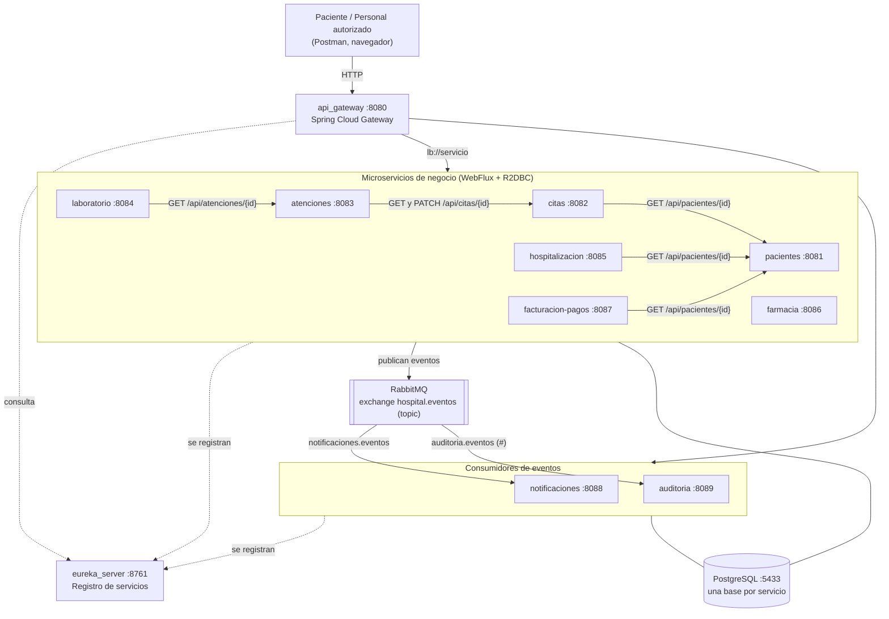

# Hospital Vida Salud — Plataforma de microservicios

Proyecto T2 del curso **Desarrollo de Aplicaciones Web II**. Reemplaza la aplicación monolítica del Hospital Vida Salud
por un conjunto de microservicios reactivos con **Spring Cloud Gateway**, **Eureka**, **RabbitMQ**,
**Spring WebFlux** y **Spring Data R2DBC** sobre **PostgreSQL**.

> Sistema académico. Todos los datos (DNI, resultados de laboratorio, pagos) son ficticios. No se usa para
> diagnosticar, recomendar tratamientos ni tomar decisiones clínicas.

El análisis completo, el diseño y la justificación de las decisiones están en el
[documento técnico](docs/DOCUMENTO_TECNICO.md).

---

## Arquitectura



| Servicio | Puerto | Ruta en el Gateway | Base de datos | Responsabilidad |
|---|---|---|---|---|
| `eureka_server` | 8761 | — | — | Registro y descubrimiento de servicios |
| `api_gateway` | 8080 | — | — | Punto de entrada único y enrutamiento |
| `pacientes` | 8081 | `/api/pacientes/**` | `hospital_pacientes` | Registro, actualización, consulta y validación de duplicados |
| `citas` | 8082 | `/api/citas/**` | `hospital_citas` | Programación, reprogramación, cancelación y estados |
| `atenciones` | 8083 | `/api/atenciones/**` | `hospital_atenciones` | Atención administrativa vinculada a una cita |
| `laboratorio` | 8084 | `/api/laboratorio/**` | `hospital_laboratorio` | Solicitudes de exámenes y resultados ficticios |
| `hospitalizacion` | 8085 | `/api/hospitalizaciones/**` | `hospital_hospitalizacion` | Ingreso, asignación de cama y alta administrativa |
| `farmacia` | 8086 | `/api/farmacia/**` | `hospital_farmacia` | Catálogo de medicamentos de prueba y dispensaciones |
| `facturacion_pagos` | 8087 | `/api/cargos/**`, `/api/pagos/**` | `hospital_facturacion` | Cargos administrativos y pagos simulados |
| `notificaciones` | 8088 | `/api/notificaciones/**` | `hospital_notificaciones` | Avisos simulados a partir de eventos |
| `auditoria` | 8089 | `/api/auditoria/**` | `hospital_auditoria` | Trazabilidad de todos los cambios de estado |

Los clientes **solo usan el puerto 8080**. Los puertos 8081–8089 son internos.

## Tecnologías

| Tecnología | Versión | Uso |
|---|---|---|
| Java (JDK) | 21 | Lenguaje |
| Spring Boot | 4.0.8 | Base de todos los servicios |
| Spring Cloud | 2025.1.3 | Gateway (WebFlux), Eureka, LoadBalancer |
| Spring WebFlux + Reactor | — | API reactiva con `Mono` y `Flux` sobre Netty |
| Spring Data R2DBC + `r2dbc-postgresql` | — | Acceso reactivo a PostgreSQL (sin JDBC) |
| Spring AMQP + RabbitMQ | 4.x | Eventos de negocio |
| PostgreSQL | 17 | Persistencia (Docker) |
| JUnit 5, Mockito, StepVerifier, WebTestClient | — | Pruebas automatizadas |
| H2 (modo PostgreSQL) vía R2DBC | — | Base en memoria para las pruebas |
| Testcontainers | 2.0 | RabbitMQ real en las pruebas de mensajería |
| Maven Wrapper (`mvnw`) | Maven 3.10 | Compilación y pruebas sin instalar Maven |

> **¿Por qué Spring Boot 4.0.8 y no 4.1?** Spring Cloud 2025.1 es la versión estable más reciente y es compatible
> con Spring Boot 4.0.x. La versión de Spring Cloud para Boot 4.1 (2026.0) todavía no tiene versión estable.

## Requisitos

- JDK 21 (por ejemplo, Amazon Corretto 21 o Eclipse Temurin 21).
- Docker Desktop (para PostgreSQL y RabbitMQ).
- Git.
- Maven **no** es necesario: cada proyecto incluye `mvnw` / `mvnw.cmd`.
- Opcional: Eclipse / Spring Tools y Postman.

## Estructura del repositorio

```
eclipse-workspace/
├── eureka_server/         Servidor Eureka
├── api_gateway/           Spring Cloud Gateway
├── pacientes/  citas/  atenciones/  laboratorio/  hospitalizacion/
├── farmacia/  facturacion_pagos/  notificaciones/  auditoria/
├── infra/postgres/        Script que crea una base por servicio
├── docs/                  Documento técnico y colección de Postman
├── docker-compose.yml     PostgreSQL + RabbitMQ
├── pom.xml                POM agregador: compila y prueba todos los módulos
├── mvnw, mvnw.cmd         Maven Wrapper para el agregador
└── .env.example           Plantilla de credenciales (el .env real no se versiona)
```

Dentro de cada microservicio:

```
src/main/java/com/example/<servicio>/
├── controller/   Endpoints REST (devuelven Mono/Flux)
├── service/      Reglas de negocio
├── repository/   Repositorios reactivos R2DBC
├── domain/       Entidades y enums de estado (con sus transiciones)
├── dto/          Contratos de entrada/salida (records con Bean Validation)
├── client/       Clientes WebClient hacia otros servicios (si los usa)
├── messaging/    Configuración de RabbitMQ, publicador o consumidor de eventos
└── exception/    BusinessException y manejador global de errores
src/main/resources/
├── application.properties
└── schema.sql    Tablas, restricciones e índices del servicio
```

> Las carpetas `CircuitBreak/`, `Feign/` y `RabbitMQ/` son ejemplos de clase y no forman parte de la solución
> del hospital (no están incluidas en el `pom.xml` agregador).

## Configuración de credenciales

Las contraseñas **no** están en el código ni en los `application.properties`; se leen de variables de entorno.

1. Copie la plantilla:
   ```bash
   cp .env.example .env          # Git Bash
   copy .env.example .env        # CMD / PowerShell
   ```
2. Cambie `DB_PASSWORD` y `RABBITMQ_PASSWORD` en `.env`.

`.env` está en `.gitignore`. Lo usan `docker-compose.yml` (para crear los contenedores) y cada microservicio
(`spring.config.import=optional:file:../.env[.properties]`). En lugar del archivo también pueden definirse
variables de entorno con los mismos nombres.

## Ejecución

### 1. Infraestructura (PostgreSQL y RabbitMQ)

```bash
docker compose up -d
docker compose ps        # ambos deben aparecer como "healthy"
```

- PostgreSQL queda en `localhost:5433` (se usa 5433 para no chocar con un PostgreSQL instalado en 5432).
  La primera vez se crean las 9 bases `hospital_*`; las tablas las crea cada servicio al iniciar (`schema.sql`).
- Panel de RabbitMQ: <http://localhost:15672> (usuario y contraseña del `.env`).

### 2. Microservicios

El orden importa solo al inicio: **primero Eureka**, luego los servicios, al final el Gateway.

**Desde Eclipse / Spring Tools:** importe los proyectos (*File → Import → Existing Maven Projects*) y ejecútelos
desde el *Boot Dashboard* o con *Run As → Spring Boot App*. La carpeta de trabajo de cada ejecución debe ser la
del proyecto (es el valor por defecto), así encuentra `../.env`.

**Desde la terminal**, una ventana por servicio:

```bash
cd eureka_server && ./mvnw spring-boot:run      # Windows: mvnw.cmd spring-boot:run
cd pacientes     && ./mvnw spring-boot:run
# ... repetir para citas, atenciones, laboratorio, hospitalizacion, farmacia,
#     facturacion_pagos, notificaciones y auditoria
cd api_gateway   && ./mvnw spring-boot:run
```

O bien empaquete todo una vez y ejecute los jars:

```bash
./mvnw package -DskipTests
cd pacientes && java -jar target/pacientes-0.0.1-SNAPSHOT.jar
```

### 3. Verificación

| Qué | Dónde |
|---|---|
| Servicios registrados en Eureka | <http://localhost:8761> |
| Rutas cargadas en el Gateway | <http://localhost:8080/actuator/gateway/routes> |
| Salud de un servicio | `http://localhost:808X/actuator/health` |
| Colas, bindings y mensajes | <http://localhost:15672> → *Queues and Streams* |

## Probar el flujo funcional

La forma más cómoda es importar en Postman la colección
[`docs/postman/HospitalVidaSalud.postman_collection.json`](docs/postman/HospitalVidaSalud.postman_collection.json).
Sus solicitudes están numeradas en el orden del flujo y guardan automáticamente los ids (paciente, cita,
atención…) para usarlos en los pasos siguientes.

Con `curl` (Git Bash), todo pasa por el Gateway:

```bash
# 1. Registrar paciente
curl -X POST http://localhost:8080/api/pacientes -H "Content-Type: application/json" \
  -d '{"tipoDocumento":"DNI","numeroDocumento":"70000001","nombres":"Ana","apellidos":"Prueba Ficticia",
       "fechaNacimiento":"1990-05-20","telefono":"900000001","correo":"ana.prueba@correo.test"}'

# 2. Consultar paciente
curl http://localhost:8080/api/pacientes/1

# 3. Registrar cita (citas valida el paciente llamando a pacientes vía Eureka)
curl -X POST http://localhost:8080/api/citas -H "Content-Type: application/json" \
  -d '{"pacienteId":1,"especialidad":"CARDIOLOGIA","fechaHora":"2030-03-04T10:00:00","profesionalCodigo":"CAR-001"}'

# 4. Confirmar cita -> publica CitaConfirmada en RabbitMQ
curl -X PATCH http://localhost:8080/api/citas/1/estado -H "Content-Type: application/json" -d '{"estado":"CONFIRMADA"}'

# 5. Ver el aviso generado por notificaciones y la traza de auditoría
curl "http://localhost:8080/api/notificaciones?pacienteId=1"
curl http://localhost:8080/api/auditoria/recursos/CITA/1

# 6. Registrar la atención (la cita pasa a ATENDIDA)
curl -X POST http://localhost:8080/api/atenciones -H "Content-Type: application/json" \
  -d '{"citaId":1,"area":"CONSULTA_EXTERNA"}'
```

> **Windows y tildes:** si el cuerpo JSON lleva tildes o ñ, el `curl` de Windows puede convertirlas al código
> de página local y el servicio responde `400 ENTRADA_INVALIDA`. Use Postman o envíe el cuerpo desde un archivo
> UTF-8: `curl ... --data-binary @cuerpo.json`.

Avisos en vivo (Server-Sent Events): `curl -N http://localhost:8080/api/notificaciones/stream` deja la conexión
abierta y muestra cada notificación en cuanto se genera.

## Pruebas automatizadas

Las pruebas **no necesitan** PostgreSQL, RabbitMQ ni Eureka en ejecución: usan H2 en memoria (vía R2DBC) y dobles
de prueba. Las dos pruebas de mensajería con RabbitMQ real usan Testcontainers y se omiten si Docker no está
disponible.

```bash
# Todos los módulos, desde la raíz
./mvnw verify            # Windows: mvnw.cmd verify

# Un solo servicio
cd citas && ./mvnw test
```

Resultado esperado: `BUILD SUCCESS` y un resumen por módulo. Los reportes quedan en
`<servicio>/target/surefire-reports/`.

| Prueba exigida | Dónde está |
|---|---|
| Registro de paciente válido | `pacientes` → `PacienteServiceTest`, `PacienteControllerTest` |
| Rechazo de paciente duplicado | `pacientes` → `PacienteServiceTest`, `PacienteControllerTest`, `PacienteRepositoryTest` |
| Registro y consulta de cita | `citas` → `CitaServiceTest`, `CitaControllerTest`, `CitaRepositoryTest` |
| Transición de estado no permitida | `citas` → `EstadoCitaTest`, `CitaServiceTest`, `CitaControllerTest` |
| Publicación y consumo de un evento | `citas` → `EventoPublisherTest`; `notificaciones` y `auditoria` → `FlujoEventoRabbitMQTest` (RabbitMQ real) |
| Monto de pago no permitido | `facturacion_pagos` → `PagoServiceTest`, `PagoControllerTest` |
| Recurso inexistente | `pacientes`, `citas`, `atenciones`, `laboratorio` → pruebas de controlador y servicio |
| Comunicación síncrona (404, servicio caído, timeout) | `citas` → `PacienteClientTest`; `atenciones` → `CitaClientTest` |
| Persistencia SQL con R2DBC | `PacienteRepositoryTest`, `CitaRepositoryTest`, `HospitalizacionRepositoryTest`, pruebas de integración de `farmacia` y `facturacion_pagos` |

## Eventos de RabbitMQ

Exchange `hospital.eventos` (tipo *topic*, durable). Cada consumidor declara su propia cola.

| Routing key | Evento | Productor | Consumidores |
|---|---|---|---|
| `paciente.registrado` / `paciente.actualizado` / `paciente.estado-actualizado` | PacienteRegistrado… | pacientes | auditoría |
| `cita.registrada` | CitaRegistrada | citas | notificaciones, auditoría |
| `cita.confirmada` | CitaConfirmada | citas | notificaciones, auditoría |
| `cita.reprogramada` / `cita.cancelada` | CitaReprogramada / CitaCancelada | citas | notificaciones, auditoría |
| `cita.atendida` / `cita.ausente` | CitaAtendida / CitaAusente | citas | auditoría |
| `atencion.registrada` / `.finalizada` / `.anulada` | Atencion… | atenciones | auditoría |
| `laboratorio.solicitud-registrada` | SolicitudLaboratorioRegistrada | laboratorio | auditoría |
| `laboratorio.estado-actualizado` | SolicitudLaboratorioActualizada | laboratorio | notificaciones, auditoría |
| `hospitalizacion.solicitada` / `.ingreso` / `.cancelada` | Hospitalizacion… | hospitalización | auditoría |
| `hospitalizacion.alta` | HospitalizacionDadaDeAlta | hospitalización | notificaciones, auditoría |
| `farmacia.dispensacion-registrada` / `-anulada` | Dispensacion… | farmacia | auditoría |
| `cargo.registrado` / `cargo.anulado` | Cargo… | facturación | auditoría |
| `pago.registrado` | PagoRegistrado | facturación | notificaciones, auditoría |

Colas: `notificaciones.eventos` (enlazada a las claves que generan un aviso) y `auditoria.eventos` (enlazada con
`#`, recibe todo). Cada una tiene su cola `.dlq` para los mensajes que fallan.

## Integración continua (GitHub Actions)

> **PENDIENTE.** El flujo de CI (`.github/workflows/ci.yml`) se implementará paso a paso en una siguiente etapa.
> El proyecto ya está preparado para ello: `./mvnw verify` en la raíz compila y prueba todos los módulos sin
> depender de servicios externos ni de credenciales.

## Seguridad y datos de prueba

- Solo datos ficticios (DNI de 8 dígitos inventados, correos `@correo.test`, resultados de demostración).
- Sin contraseñas, tokens ni cadenas de conexión con credenciales en el repositorio: se leen de `.env` o de
  variables de entorno.
- Los logs registran ids y estados, no nombres ni documentos de los pacientes.
- Los eventos solo llevan el id del paciente; el resultado ficticio de laboratorio no viaja en los eventos.
