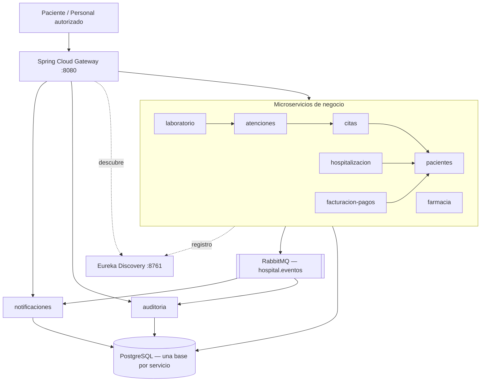
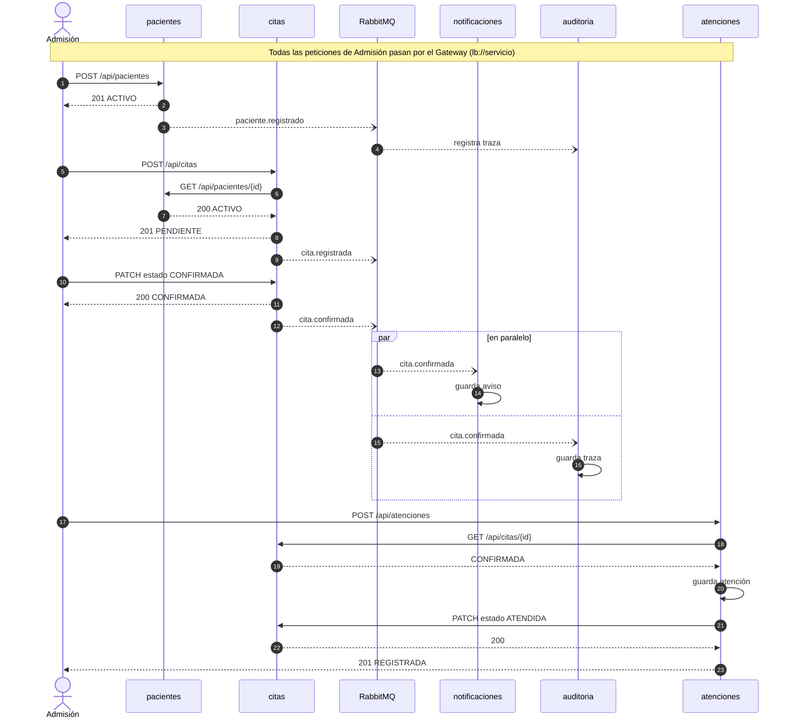
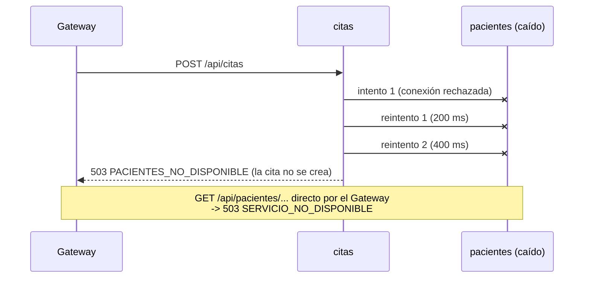
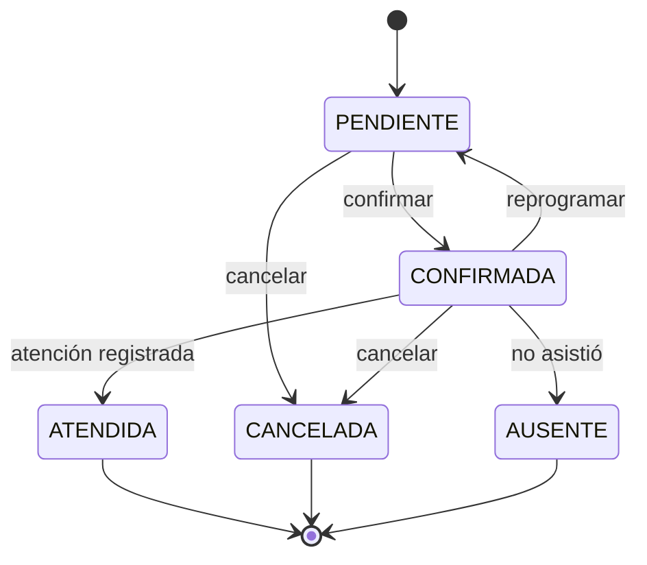

# Documento técnico — Hospital Vida Salud

**Curso:** Desarrollo de Aplicaciones Web II — T2
**Tipo de solución:** arquitectura basada en microservicios
**Autor:** Daniel Fuentes Martel

> Sistema académico. Toda la información usada (documentos de identidad, resultados de laboratorio, pagos) es
> ficticia. El sistema no diagnostica, no recomienda tratamientos y no toma decisiones clínicas.

## Contenido

1. [Descripción del problema y alcance](#1-descripción-del-problema-y-alcance)
2. [Análisis del negocio](#2-análisis-del-negocio)
3. [Identificación de microservicios](#3-identificación-de-microservicios)
4. [Diagramas de arquitectura y comunicación](#4-diagramas-de-arquitectura-y-comunicación)
5. [Diseño de datos y propiedad de los datos](#5-diseño-de-datos-y-propiedad-de-los-datos)
6. [Endpoints y contratos entre servicios](#6-endpoints-y-contratos-entre-servicios)
7. [Comunicación síncrona y asíncrona](#7-comunicación-síncrona-y-asíncrona)
8. [Gateway, Eureka, RabbitMQ, WebFlux y R2DBC](#8-gateway-eureka-rabbitmq-webflux-y-r2dbc)
9. [Estados y trazabilidad](#9-estados-y-trazabilidad)
10. [Pruebas automatizadas](#10-pruebas-automatizadas)
11. [Integración continua (PENDIENTE)](#11-integración-continua-pendiente)
12. [Ejecución de la solución y de las pruebas](#12-ejecución-de-la-solución-y-de-las-pruebas)
13. [Evidencias](#13-evidencias)
14. [Limitaciones y mejoras](#14-limitaciones-y-mejoras)
15. [Respuesta a la pregunta principal](#15-respuesta-a-la-pregunta-principal)

---

## 1. Descripción del problema y alcance

### 1.1 Situación actual

El Hospital Vida Salud opera con una aplicación monolítica que concentra pacientes, citas, atención, laboratorio,
hospitalización, farmacia, facturación, notificaciones y reportes. Con el crecimiento de la demanda aparecen:

| Problema del monolito | Consecuencia |
|---|---|
| Un solo proceso y una sola base para todo | Saturación en horas punta: la consulta de citas compite con facturación y reportes |
| Alto acoplamiento entre módulos | Cambiar farmacia obliga a probar y desplegar todo el sistema |
| Despliegue único | Publicar una corrección es riesgoso: un error en un módulo detiene a los demás |
| Escalado en bloque | No se puede escalar solo el módulo de citas, que es el de mayor demanda |
| Comunicación interna directa entre módulos | Los avisos y la auditoría retrasan la operación principal |
| Duplicación de información | Varias pantallas mantienen su propia copia de datos del paciente |

### 1.2 Objetivo

Separar los procesos hospitalarios en microservicios con responsabilidades claras, datos propios y capacidad de
evolucionar por separado, con un punto de entrada único, descubrimiento dinámico, eventos asíncronos para los
procesos secundarios, persistencia reactiva y pruebas automatizadas.

### 1.3 Alcance implementado

| Proceso del caso | Microservicio | Profundidad |
|---|---|---|
| 1. Registro del paciente | `pacientes` | Completo: registro, actualización, consulta, activación/inactivación, duplicados |
| 2. Programación de citas | `citas` | Completo: programación, reprogramación, cancelación, estados y agenda simplificada |
| 3. Atención | `atenciones` | Completo: atención vinculada a cita confirmada, con acción compensatoria |
| 4. Laboratorio | `laboratorio` | Completo: solicitud ligada a la atención, estados y resultado ficticio |
| 5. Hospitalización | `hospitalizacion` | Completo: solicitud, ingreso con cama, alta y cancelación |
| 6. Farmacia | `farmacia` | Catálogo de prueba, dispensación con control de stock y anulación |
| 7. Facturación y pagos | `facturacion_pagos` | Cargos y pagos simulados con validación de monto y número de operación |
| 8. Notificaciones | `notificaciones` | Avisos simulados (BD + log + flujo en vivo SSE) generados por eventos |
| Trazabilidad | `auditoria` | Registro de todos los cambios de estado a partir de eventos |

Fuera de alcance: autenticación/autorización, envío real de correos o SMS, historia clínica, prescripción,
pasarela de pagos real y despliegue automático.

---

## 2. Análisis del negocio

### 2.1 Actores

| Actor | Interacción con el sistema |
|---|---|
| Paciente | Recibe avisos de citas, laboratorio, alta y pagos (`notificaciones`) |
| Personal de admisión | Registra pacientes y gestiona citas (`pacientes`, `citas`) |
| Personal de salud | Registra la atención administrativa y solicita exámenes (`atenciones`, `laboratorio`) |
| Laboratorio | Cambia el estado de las solicitudes y registra resultados ficticios (`laboratorio`) |
| Farmacia | Mantiene el catálogo y registra dispensaciones de prueba (`farmacia`) |
| Caja / administración | Genera cargos y registra pagos simulados (`facturacion_pagos`) |
| Administrador del sistema | Supervisa servicios en Eureka, colas en RabbitMQ y la auditoría |
| Equipo de desarrollo | Mantiene el código, las pruebas y el flujo de integración continua |

### 2.2 Reglas de negocio

Cada regla tiene un código que aparece en las respuestas de error (`"codigo": "RN-05"`), en el código fuente y en
las pruebas.

| Código | Regla | Servicio | Respuesta |
|---|---|---|---|
| RN-01 | No se repite el mismo tipo y número de documento de paciente | pacientes | 409 |
| RN-02 | El número corresponde al tipo de documento (DNI: 8 dígitos; CE: 9–12 alfanuméricos; pasaporte: 6–12) | pacientes | 400 |
| RN-03 | Solo un paciente ACTIVO puede recibir citas, hospitalizaciones o cargos | citas, hospitalización, facturación | 409 |
| RN-04 | La cita respeta la agenda: lunes a sábado, 08:00–20:00, bloques de 30 minutos, fecha futura | citas | 400 |
| RN-05 | Ni el profesional ni el paciente pueden tener dos citas activas en el mismo horario | citas | 409 |
| RN-06 | La cita solo cambia de estado por transiciones permitidas (ver §9) | citas | 409 |
| RN-07 | La atención requiere una cita CONFIRMADA y hay una sola atención por cita | atenciones | 409 |
| RN-08 | La solicitud de laboratorio requiere una atención existente no anulada; estados controlados; resultado ficticio solo al completar | laboratorio | 400 / 409 |
| RN-09 | Una cama ocupada no se asigna a otra hospitalización activa; un paciente no tiene dos hospitalizaciones abiertas | hospitalización | 409 |
| RN-10 | La dispensación tiene cantidad > 0 y no deja el stock en negativo | farmacia | 400 / 409 |
| RN-11 | El pago tiene monto > 0, número de operación único y cubre el total de un cargo PENDIENTE | facturación | 400 / 409 |
| RN-12 | Los cambios de estado importantes quedan registrados y se publican como eventos | todos | — |

**Supuestos de la agenda simplificada (RN-04/RN-05):** no se modela un calendario de turnos por profesional;
el profesional se identifica con un código ficticio (`CAR-001`) y se asume disponible en todo el horario de
atención. Una cita ocupa un bloque de 30 minutos. Al reprogramar, la cita vuelve a PENDIENTE para confirmarse otra vez.

### 2.3 Entidades

| Entidad | Servicio propietario | Campos principales |
|---|---|---|
| Paciente | pacientes | id, tipo y número de documento, nombres, apellidos, fecha de nacimiento, teléfono, correo, dirección, estado, fecha de registro |
| Cita | citas | id, código, paciente, especialidad, fecha y hora, profesional, motivo, estado, fechas de creación y actualización |
| Atención | atenciones | id, código, paciente, cita, área, observación administrativa, estado, fecha |
| Solicitud de laboratorio | laboratorio | id, código, paciente, atención, tipo de examen, estado, resultado ficticio, fechas |
| Hospitalización | hospitalización | id, código, paciente, área, cama, estado, fechas de solicitud, ingreso y alta |
| Medicamento / Dispensación | farmacia | código, nombre, presentación, stock / medicamento, paciente, cantidad, referencia, estado |
| Cargo / Pago | facturación | concepto, monto, estado / cargo, monto, medio, número de operación, fecha |
| Notificación | notificaciones | evento, paciente, asunto, mensaje, canal simulado, fecha |
| Registro de auditoría | auditoría | evento, origen, recurso, estado anterior, estado nuevo, fecha |

### 2.4 Eventos de negocio

Todos los eventos usan el mismo sobre JSON (`EventoDominio`):

```json
{
  "eventoId": "6371f262-e9c0-4a4e-98b0-2aef005204f1",
  "tipo": "CitaConfirmada",
  "origen": "citas",
  "recurso": "CITA",
  "recursoId": "3",
  "pacienteId": 3,
  "estadoAnterior": "PENDIENTE",
  "estadoNuevo": "CONFIRMADA",
  "detalle": "Cita CIT-3CCD2B64 de PEDIATRIA el 2026-10-12T15:00 (PED-001): CONFIRMADA",
  "fecha": "2026-10-10T21:13:40.512"
}
```

- `eventoId` permite a los consumidores descartar entregas duplicadas.
- `estadoAnterior`, `estadoNuevo`, `origen` y `fecha` cubren lo que exige la trazabilidad.
- Solo viaja el id del paciente, nunca nombres ni documentos.

La lista completa de eventos y routing keys está en la sección [8.3](#83-rabbitmq).

---

## 3. Identificación de microservicios

### 3.1 Criterio de división

Se separó por **capacidad de negocio**: cada servicio corresponde a un área del hospital con su propio ciclo de
vida de datos y sus propias reglas. Se evitó dividir artificialmente:

- No hay un servicio por tabla: `farmacia` administra medicamentos y dispensaciones juntos porque la dispensación
  modifica el stock en la misma transacción. Lo mismo ocurre con cargos y pagos en `facturacion_pagos`.
- Notificaciones y auditoría son servicios aparte porque son procesos secundarios: si fallan o se demoran, la
  operación principal (registrar una cita) no debe verse afectada.
- Atención y cita son servicios distintos: la cita pertenece a la agenda (admisión) y la atención al acto
  administrativo del personal de salud; tienen estados y responsables diferentes.

### 3.2 Ficha de cada servicio

#### pacientes (8081)
- **Responsabilidad:** registro único del paciente; es la fuente de verdad de sus datos y de su estado.
- **Entidades:** `paciente`.
- **Endpoints:** `POST /api/pacientes`, `GET /api/pacientes[?estado=]`, `GET /api/pacientes/{id}`,
  `GET /api/pacientes/documento/{tipo}/{numero}`, `PUT /api/pacientes/{id}`, `PATCH /api/pacientes/{id}/estado`.
- **Base:** `hospital_pacientes`.
- **Publica:** `paciente.registrado`, `paciente.actualizado`, `paciente.estado-actualizado`.
- **Consume / depende de:** nadie. Es consultado por citas, hospitalización y facturación.

#### citas (8082)
- **Responsabilidad:** agenda y ciclo de vida de la cita.
- **Entidades:** `cita`.
- **Endpoints:** `POST /api/citas`, `GET /api/citas[?pacienteId=&estado=]`, `GET /api/citas/{id}`,
  `GET /api/citas/codigo/{codigo}`, `PATCH /api/citas/{id}/estado`, `PUT /api/citas/{id}/reprogramacion`.
- **Base:** `hospital_citas`.
- **Publica:** `cita.registrada`, `cita.confirmada`, `cita.reprogramada`, `cita.cancelada`, `cita.atendida`, `cita.ausente`.
- **Depende de:** `pacientes` (síncrono, para validar que el paciente existe y está ACTIVO).

#### atenciones (8083)
- **Responsabilidad:** registro administrativo de la atención asociada a una cita.
- **Entidades:** `atencion`.
- **Endpoints:** `POST /api/atenciones`, `GET /api/atenciones[?pacienteId=]`, `GET /api/atenciones/{id}`,
  `PATCH /api/atenciones/{id}/estado`.
- **Base:** `hospital_atenciones`.
- **Publica:** `atencion.registrada`, `atencion.finalizada`, `atencion.anulada`.
- **Depende de:** `citas` (síncrono: consulta la cita y pide marcarla ATENDIDA).

#### laboratorio (8084)
- **Responsabilidad:** solicitudes de exámenes de demostración y su seguimiento.
- **Entidades:** `solicitud_laboratorio`.
- **Endpoints:** `POST /api/laboratorio/solicitudes`, `GET /api/laboratorio/solicitudes[?pacienteId=&atencionId=&estado=]`,
  `GET /api/laboratorio/solicitudes/{id}`, `PATCH /api/laboratorio/solicitudes/{id}/estado`.
- **Base:** `hospital_laboratorio`.
- **Publica:** `laboratorio.solicitud-registrada`, `laboratorio.estado-actualizado`.
- **Depende de:** `atenciones` (síncrono, valida la atención y obtiene el paciente).

#### hospitalizacion (8085)
- **Responsabilidad:** ingreso, asignación de cama y alta administrativa simulada.
- **Entidades:** `hospitalizacion`.
- **Endpoints:** `POST /api/hospitalizaciones`, `GET /api/hospitalizaciones[?pacienteId=&estado=]`,
  `GET /api/hospitalizaciones/{id}`, `PATCH /{id}/ingreso`, `PATCH /{id}/alta`, `PATCH /{id}/cancelacion`.
- **Base:** `hospital_hospitalizacion`.
- **Publica:** `hospitalizacion.solicitada`, `hospitalizacion.ingreso`, `hospitalizacion.alta`, `hospitalizacion.cancelada`.
- **Depende de:** `pacientes` (síncrono).

#### farmacia (8086)
- **Responsabilidad:** catálogo de productos de prueba, stock de demostración y dispensaciones.
- **Entidades:** `medicamento`, `dispensacion`.
- **Endpoints:** `POST/GET /api/farmacia/medicamentos`, `GET /api/farmacia/medicamentos/{id}`,
  `PATCH /api/farmacia/medicamentos/{id}/stock`, `POST/GET /api/farmacia/dispensaciones`,
  `GET /api/farmacia/dispensaciones/{id}`, `PATCH /api/farmacia/dispensaciones/{id}/anulacion`.
- **Base:** `hospital_farmacia` (con un catálogo inicial de 3 productos de demostración en `data.sql`).
- **Publica:** `farmacia.dispensacion-registrada`, `farmacia.dispensacion-anulada`.
- **Depende de:** nadie. La dispensación guarda el `pacienteId` y una referencia administrativa (por ejemplo el
  código de la atención) como identificadores; farmacia sigue operando aunque otros servicios no respondan.

#### facturacion_pagos (8087, nombre en Eureka `facturacion-pagos`)
- **Responsabilidad:** cargos administrativos de ejemplo y pagos simulados.
- **Entidades:** `cargo`, `pago`.
- **Endpoints:** `POST/GET /api/cargos`, `GET /api/cargos/{id}`, `PATCH /api/cargos/{id}/anulacion`,
  `POST/GET /api/pagos`, `GET /api/pagos/{id}`, `GET /api/pagos/operacion/{numero}`.
- **Base:** `hospital_facturacion`.
- **Publica:** `cargo.registrado`, `cargo.anulado`, `pago.registrado`.
- **Depende de:** `pacientes` (síncrono, al crear el cargo).

#### notificaciones (8088)
- **Responsabilidad:** convertir eventos en avisos simulados para el paciente.
- **Entidades:** `notificacion`.
- **Endpoints (solo lectura):** `GET /api/notificaciones[?pacienteId=]`, `GET /api/notificaciones/{id}`,
  `GET /api/notificaciones/stream` (Server-Sent Events).
- **Base:** `hospital_notificaciones`.
- **Consume:** cola `notificaciones.eventos`.

#### auditoria (8089)
- **Responsabilidad:** trazabilidad de todos los cambios importantes.
- **Entidades:** `registro_auditoria`.
- **Endpoints (solo lectura):** `GET /api/auditoria[?pacienteId=]`, `GET /api/auditoria/{id}`,
  `GET /api/auditoria/recursos/{recurso}/{recursoId}` (historial de un recurso).
- **Base:** `hospital_auditoria`.
- **Consume:** cola `auditoria.eventos` (todos los eventos).

#### Infraestructura
- **eureka_server (8761):** registro de servicios.
- **api_gateway (8080):** punto de entrada, enrutamiento por nombre lógico, trazas y manejo de servicios caídos.

---

## 4. Diagramas de arquitectura y comunicación

### 4.1 Arquitectura



### 4.2 Flujo principal (síncrono + asíncrono)



### 4.3 Comportamiento ante un servicio caído



---

## 5. Diseño de datos y propiedad de los datos

### 5.1 Una base por servicio

Se usa un solo servidor PostgreSQL (por simplicidad académica) con **una base de datos por servicio**
(`hospital_pacientes`, `hospital_citas`…). Cada servicio solo tiene la URL de su propia base, así que técnicamente
no puede leer las tablas de otro. La única forma de obtener datos de otro servicio es su API o sus eventos.

**Limitación documentada:** al compartir el servidor, una caída de PostgreSQL afecta a todos los servicios. En
producción cada base podría estar en su propio servidor sin cambiar el código (solo la URL).

### 5.2 Referencias entre servicios

`cita.paciente_id`, `atencion.cita_id`, `solicitud_laboratorio.atencion_id`, etc. son **referencias lógicas**: se
guardan como identificadores, sin `FOREIGN KEY`, porque apuntan a otra base. Su existencia se valida llamando al
servicio dueño en el momento de crear el registro (contrato síncrono, §6.2).

Solo se usan claves foráneas entre tablas de la **misma** base:
`dispensacion.medicamento_id → medicamento.id` y `pago.cargo_id → cargo.id`.

### 5.3 Tablas, claves, restricciones e índices

El DDL de cada servicio está en `src/main/resources/schema.sql` y es compatible con PostgreSQL y con H2 (pruebas).

| Tabla | Clave primaria | Restricciones | Índices |
|---|---|---|---|
| `paciente` | `id` identity | `UNIQUE (tipo_documento, numero_documento)` (RN-01), `CHECK` de tipo y estado | `estado`, `apellidos` |
| `cita` | `id` identity | `UNIQUE (codigo)`, `CHECK` de estado | `(paciente_id, fecha_hora)`, `(profesional_codigo, fecha_hora)` (RN-05) |
| `atencion` | `id` identity | `UNIQUE (codigo)`, `UNIQUE (cita_id)` (RN-07), `CHECK` de estado | `(paciente_id, fecha_atencion)` |
| `solicitud_laboratorio` | `id` identity | `UNIQUE (codigo)`, `CHECK` de estado | `(paciente_id, fecha_solicitud)`, `atencion_id` |
| `hospitalizacion` | `id` identity | `UNIQUE (codigo)`, `UNIQUE (cama_ocupada)` (RN-09), `CHECK` de estado | `(paciente_id, estado)` |
| `medicamento` | `id` identity | `UNIQUE (codigo)`, `CHECK (stock >= 0)` (RN-10) | — |
| `dispensacion` | `id` identity | `UNIQUE (codigo)`, `FK medicamento`, `CHECK (cantidad > 0)`, `CHECK` de estado | `(paciente_id, fecha_dispensacion)` |
| `cargo` | `id` identity | `UNIQUE (codigo)`, `CHECK (monto > 0)`, `CHECK` de estado | `(paciente_id, fecha_registro)` |
| `pago` | `id` identity | `UNIQUE (numero_operacion)`, `CHECK (monto > 0)` (RN-11), `FK cargo` | `(paciente_id, fecha_pago)` |
| `notificacion` | `id` identity | `UNIQUE (evento_id)` (idempotencia) | `(paciente_id, fecha_registro)` |
| `registro_auditoria` | `id` identity | `UNIQUE (evento_id)` (idempotencia) | `(recurso, recurso_id, fecha_evento)`, `(paciente_id, fecha_evento)` |

Decisiones relevantes:

- **Doble defensa en las reglas críticas.** El servicio valida antes de guardar (respuesta clara) y la base de
  datos tiene la restricción equivalente (garantía ante peticiones simultáneas). Ejemplo: dos registros del mismo
  DNI al mismo tiempo pasan ambos el `exists`, pero el segundo choca con el `UNIQUE` y se responde 409 igualmente.
- **Cama ocupada (RN-09).** La columna `cama_ocupada` tiene el código de la cama solo mientras la hospitalización
  está ACTIVA y `NULL` en los demás estados. Como `UNIQUE` admite varios `NULL`, la base impide dos
  hospitalizaciones activas en la misma cama sin bloquear el historial. Se eligió esta técnica en lugar de un
  índice parcial (`WHERE estado = 'ACTIVA'`) porque H2, usado en las pruebas, no los soporta.
- **Stock (RN-10).** El descuento se hace en una sola sentencia
  `UPDATE medicamento SET stock = stock - :cantidad WHERE id = :id AND stock >= :cantidad`; si devuelve 0 filas no
  había stock. Dos dispensaciones simultáneas no pueden dejar el stock en negativo.

### 5.4 Propiedad de los datos

| Dato | Dueño (único que lo modifica) | Quién lo consulta y cómo |
|---|---|---|
| Paciente y su estado | pacientes | citas, hospitalización, facturación: `GET /api/pacientes/{id}` |
| Cita y su estado | citas | atenciones: `GET /api/citas/{id}`; atenciones pide el cambio a ATENDIDA vía `PATCH`, pero es citas quien valida y aplica la transición |
| Atención | atenciones | laboratorio: `GET /api/atenciones/{id}` |
| Solicitud de laboratorio | laboratorio | notificaciones y auditoría, por eventos |
| Hospitalización y camas | hospitalización | notificaciones y auditoría, por eventos |
| Stock y dispensaciones | farmacia | auditoría, por eventos |
| Cargos y pagos | facturación | notificaciones y auditoría, por eventos |
| Notificaciones | notificaciones | API de consulta |
| Trazas | auditoría | API de consulta |

---

## 6. Endpoints y contratos entre servicios

### 6.1 Formato de error común

Todos los servicios responden los errores con el mismo formato:

```json
{
  "fecha": "2026-10-10T21:11:07.4965529",
  "status": 409,
  "codigo": "RN-06",
  "mensaje": "No se puede cambiar una cita CONFIRMADA a PENDIENTE"
}
```

| HTTP | Cuándo |
|---|---|
| 400 | Datos inválidos (`VALIDACION`, con el detalle por campo en `errores`), JSON mal formado o enum inexistente (`ENTRADA_INVALIDA`), regla de formato (RN-02, RN-04…) |
| 404 | Recurso inexistente (`PACIENTE_NO_ENCONTRADO`, `CITA_NO_ENCONTRADA`…) |
| 409 | Conflicto con una regla de negocio o con el estado actual (RN-01, RN-05, RN-06…) |
| 503 | Un servicio del que se depende no responde (`PACIENTES_NO_DISPONIBLE`, `SERVICIO_NO_DISPONIBLE`) |
| 500 | Error no previsto (se registra en el log; al cliente no se le muestran detalles internos) |

### 6.2 Contratos síncronos entre servicios

| Consumidor | Proveedor | Llamada | Respuestas esperadas | Uso |
|---|---|---|---|---|
| citas | pacientes | `GET /api/pacientes/{id}` | 200 `{id, estado…}` / 404 | Validar existencia y estado ACTIVO antes de crear la cita |
| hospitalización | pacientes | `GET /api/pacientes/{id}` | 200 / 404 | Validar el paciente antes de la solicitud |
| facturación | pacientes | `GET /api/pacientes/{id}` | 200 / 404 | Validar el paciente antes de crear el cargo |
| atenciones | citas | `GET /api/citas/{id}` | 200 `{id, pacienteId, estado…}` / 404 | Verificar que la cita está CONFIRMADA |
| atenciones | citas | `PATCH /api/citas/{id}/estado` `{"estado":"ATENDIDA"}` | 200 / 404 / 409 | Pedir a citas que marque la cita como ATENDIDA |
| laboratorio | atenciones | `GET /api/atenciones/{id}` | 200 `{id, pacienteId, estado…}` / 404 | Validar la atención y obtener el paciente |

**Cómo se implementan:** con `WebClient` (no bloqueante) creado desde un `WebClient.Builder` anotado con
`@LoadBalanced`. La URL base es el nombre lógico del servicio (`http://pacientes`), que Spring Cloud LoadBalancer
resuelve consultando Eureka. Los consumidores leen solo los campos que necesitan (`@JsonIgnoreProperties(ignoreUnknown = true)`),
de modo que si el proveedor agrega campos no se rompe el contrato.

**Errores, tiempos de espera e indisponibilidad:**

| Situación | Comportamiento |
|---|---|
| 404 del proveedor | Se traduce a 404 propio (`PACIENTE_NO_ENCONTRADO`…). No se reintenta. |
| 409 del proveedor (PATCH de citas) | Se traduce a 409 RN-07. No se reintenta. |
| Sin conexión, 5xx o sin instancias en Eureka | Se reintenta 2 veces con espera creciente (200 ms, 400 ms) y luego 503 `XXX_NO_DISPONIBLE`. |
| Sin respuesta en `servicios.timeout` (3 s) | Se cuenta como fallo transitorio: reintentos y luego 503. |
| PATCH a citas | No se reintenta: si el primer intento llegó a aplicarse, un reintento recibiría 409 y se confundiría con un rechazo real. |
| Citas rechaza el PATCH después de guardar la atención | Acción compensatoria: atenciones elimina la atención recién guardada y devuelve el error. Así no queda una atención con su cita sin ATENDIDA. |

Verificado en ejecución: con `pacientes` detenido, `POST /api/citas` respondió `503 PACIENTES_NO_DISPONIBLE` en
0,9 s y la cita no se creó; al reiniciar `pacientes`, el sistema volvió a responder 200/201 en unos 6 s sin
reiniciar ningún otro servicio.

### 6.3 Endpoints públicos (a través del Gateway, puerto 8080)

| Método | Ruta | Descripción |
|---|---|---|
| POST | `/api/pacientes` | Registrar paciente |
| GET | `/api/pacientes`, `/api/pacientes/{id}`, `/api/pacientes/documento/{tipo}/{numero}` | Consultar |
| PUT | `/api/pacientes/{id}` | Actualizar datos |
| PATCH | `/api/pacientes/{id}/estado` | Activar / inactivar |
| POST | `/api/citas` | Programar cita |
| GET | `/api/citas`, `/api/citas/{id}`, `/api/citas/codigo/{codigo}` | Consultar |
| PATCH | `/api/citas/{id}/estado` | Confirmar, cancelar, atendida, ausente |
| PUT | `/api/citas/{id}/reprogramacion` | Reprogramar |
| POST | `/api/atenciones` | Registrar atención |
| GET | `/api/atenciones`, `/api/atenciones/{id}` | Consultar |
| PATCH | `/api/atenciones/{id}/estado` | Finalizar / anular |
| POST | `/api/laboratorio/solicitudes` | Solicitar examen |
| GET | `/api/laboratorio/solicitudes`, `/api/laboratorio/solicitudes/{id}` | Consultar |
| PATCH | `/api/laboratorio/solicitudes/{id}/estado` | En proceso, completado (con resultado ficticio), cancelado |
| POST | `/api/hospitalizaciones` | Solicitar hospitalización |
| PATCH | `/api/hospitalizaciones/{id}/ingreso`, `/alta`, `/cancelacion` | Ingreso con cama, alta, cancelación |
| GET | `/api/hospitalizaciones`, `/api/hospitalizaciones/{id}` | Consultar |
| GET / POST | `/api/farmacia/medicamentos` | Catálogo |
| PATCH | `/api/farmacia/medicamentos/{id}/stock` | Reponer stock |
| POST | `/api/farmacia/dispensaciones` | Dispensar |
| PATCH | `/api/farmacia/dispensaciones/{id}/anulacion` | Anular dispensación |
| POST | `/api/cargos` | Generar cargo |
| PATCH | `/api/cargos/{id}/anulacion` | Anular cargo |
| POST | `/api/pagos` | Registrar pago |
| GET | `/api/pagos`, `/api/pagos/{id}`, `/api/pagos/operacion/{numero}` | Consultar |
| GET | `/api/notificaciones`, `/api/notificaciones/{id}` | Avisos simulados |
| GET | `/api/notificaciones/stream` | Avisos en vivo (SSE) |
| GET | `/api/auditoria`, `/api/auditoria/{id}`, `/api/auditoria/recursos/{recurso}/{id}` | Trazabilidad |

---

## 7. Comunicación síncrona y asíncrona

| Se usa **síncrona** (HTTP + WebClient) cuando… | Se usa **asíncrona** (RabbitMQ) cuando… |
|---|---|
| La operación **no puede continuar** sin la respuesta | La operación principal **ya terminó** y hay que avisar a otros |
| Hay que validar una regla con datos de otro servicio en ese instante | El receptor puede procesar después sin afectar al usuario |
| El usuario espera el resultado en la misma petición | Puede haber varios interesados y el productor no debe conocerlos |
| Ejemplos: citas valida el paciente; atenciones valida la cita; laboratorio valida la atención | Ejemplos: CitaConfirmada → notificaciones y auditoría; PagoRegistrado; HospitalizacionDadaDeAlta |

**Por qué los avisos no son síncronos:** si citas llamara por HTTP a notificaciones y a auditoría, una demora en
cualquiera de ellos haría lenta la confirmación de la cita, y una caída la haría fallar. Con RabbitMQ, citas
publica el evento y responde de inmediato; si notificaciones está caído, los mensajes esperan en su cola y se
procesan cuando vuelve.

**Cómo se evita el acoplamiento directo:**

- El productor solo conoce el exchange `hospital.eventos` y la routing key; no sabe qué colas existen.
- Cada consumidor declara su propia cola y decide qué claves escuchar. Agregar un consumidor nuevo (por ejemplo,
  un servicio de reportes) no requiere tocar a los productores.
- El contrato es el JSON del evento. Cada servicio tiene su propia copia del record `EventoDominio`; no hay una
  librería compartida que obligue a desplegar todos los servicios juntos.

---

## 8. Gateway, Eureka, RabbitMQ, WebFlux y R2DBC

### 8.1 Spring Cloud Gateway

- Proyecto `api_gateway`, puerto 8080, implementación reactiva (`spring-cloud-starter-gateway-server-webflux`).
- Rutas declaradas en `application.properties`: cada predicado `Path=/api/<recurso>/**` apunta a
  `lb://<nombre-en-eureka>`. El prefijo `lb://` indica que el destino se resuelve con el balanceador usando Eureka.
- `TrazaGlobalFilter`: agrega un `X-Correlation-Id` a cada petición (lo reenvía al microservicio y lo devuelve al
  cliente) y registra ruta, destino, código y tiempo. Ejemplo real del log:
  `POST /api/citas -> ruta citas (localhost:8082) | 201 CREATED | 86 ms | ed1b1536-…`
- `ServicioNoDisponibleFilter`: si la instancia está caída pero Eureka todavía la lista, responde
  `503 SERVICIO_NO_DISPONIBLE` en lugar de un 500 genérico.
- Tiempos de espera: 2 s para conectar y 10 s para responder (después, 504 Gateway Timeout).
- `/actuator/gateway/routes` muestra las rutas cargadas (evidencia de configuración).

**Por qué los clientes no deben depender de los puertos internos:** los puertos son un detalle de despliegue que
cambia (una segunda instancia de citas tendría otro puerto, un contenedor tendría otra IP). Si el cliente conoce
solo `http://gateway/api/citas`, se pueden agregar instancias, moverlas o reemplazarlas sin cambiar a los clientes.
Además, el Gateway es el lugar único para aplicar políticas transversales (trazas, tiempos de espera, CORS y, como
mejora, autenticación).

### 8.2 Eureka

- Proyecto `eureka_server`, puerto 8761, `@EnableEurekaServer`. Panel en <http://localhost:8761>.
- Cada servicio (y el Gateway) se registra al iniciar con su `spring.application.name` y un id de instancia
  `nombre:puerto`, y envía un latido periódico.
- Se desactivó la autopreservación (`enable-self-preservation=false`) porque en un entorno de una sola máquina
  conviene que un servicio detenido desaparezca del panel en segundos.

**Cómo se localiza una instancia:** cuando citas llama a `http://pacientes/api/pacientes/1`:

1. El `WebClient` con `@LoadBalanced` intercepta la llamada y ve que `pacientes` es un nombre lógico.
2. Spring Cloud LoadBalancer pide a su caché local la lista de instancias de `PACIENTES` (la caché se actualiza
   descargando el registro de Eureka periódicamente).
3. Elige una instancia (round-robin) y reemplaza el host: `http://localhost:8081/api/pacientes/1`.
4. Si no hay instancias, responde 503 y el cliente lo trata como fallo transitorio.

El Gateway hace lo mismo con las rutas `lb://`.

**Nombre `facturacion-pagos`:** el proyecto se llama `facturacion_pagos`, pero el nombre en Eureka usa guion porque
se usa como host en una URI (`lb://facturacion-pagos`) y los nombres de host no admiten guion bajo.

### 8.3 RabbitMQ

- **Exchange:** `hospital.eventos`, tipo *topic*, durable. Todos los servicios lo declaran (la declaración es
  idempotente), así no importa el orden de arranque.
- **Productores:** todos los servicios de negocio, con `EventoPublisher` (`RabbitTemplate` + conversor JSON).
- **Colas y consumidores:**

| Cola | Bindings (routing keys) | Consumidor | DLQ |
|---|---|---|---|
| `notificaciones.eventos` | `cita.registrada`, `cita.confirmada`, `cita.reprogramada`, `cita.cancelada`, `laboratorio.estado-actualizado`, `hospitalizacion.alta`, `pago.registrado` | notificaciones | `notificaciones.eventos.dlq` |
| `auditoria.eventos` | `#` (todas) | auditoría | `auditoria.eventos.dlq` |

- **Routing keys:** formato `<recurso>.<acción>` (por ejemplo, `cita.confirmada`). La lista completa está en el README.

**Flujo implementado y demostrado (CitaConfirmada):**

```
PATCH /api/citas/{id}/estado {"estado":"CONFIRMADA"}
  -> citas guarda el cambio y publica en hospital.eventos con routing key cita.confirmada
  -> RabbitMQ copia el mensaje a notificaciones.eventos (binding cita.confirmada)
                         y a auditoria.eventos (binding #)
  -> notificaciones guarda el aviso "Confirmación de cita", lo registra en el log y lo envía por SSE
  -> auditoría guarda la traza PENDIENTE -> CONFIRMADA (origen citas)
```

**Robustez:**

| Mecanismo | Implementación |
|---|---|
| Publicación no bloqueante | `RabbitTemplate` es bloqueante; se ejecuta en `Schedulers.boundedElastic()` para no ocupar los hilos de Netty |
| RabbitMQ caído al publicar | Se registra el error y la operación de negocio se mantiene (los eventos alimentan procesos secundarios). Ver §14 |
| Consumidor reactivo | El `@RabbitListener` devuelve `Mono<Void>`: Spring AMQP confirma (ack) el mensaje cuando el `Mono` termina |
| Reintentos | `retryWhen(Retry.backoff(2, 1s))` en el consumidor |
| Mensajes que siguen fallando | Se rechazan sin reencolar (`default-requeue-rejected=false`) y RabbitMQ los mueve a la cola `.dlq` |
| Entregas duplicadas | `UNIQUE (evento_id)` en las tablas de los consumidores: la segunda entrega se ignora |

### 8.4 Spring WebFlux, Mono y Flux

Todos los servicios usan Spring WebFlux sobre Netty (no hay Tomcat ni Spring MVC en las dependencias). El flujo es
reactivo de punta a punta: controlador → servicio → repositorio R2DBC / WebClient / RabbitMQ.

| Tipo | Se usa para | Ejemplo |
|---|---|---|
| `Mono<T>` | Cero o un resultado | `Mono<CitaResponse> registrar(...)`, `Mono<PacienteDto> obtenerPaciente(id)` |
| `Flux<T>` | Conjuntos o secuencias | `Flux<CitaResponse> listar(...)`, `Flux<ServerSentEvent<...>> enVivo()` |

Errores: los servicios devuelven `Mono.error(new BusinessException(status, codigo, mensaje))` y un
`@RestControllerAdvice` los convierte en la respuesta HTTP correspondiente. Los recursos inexistentes se detectan
con `switchIfEmpty(Mono.error(...))`.

No hay llamadas bloqueantes en el pipeline: no se usa JDBC ni `block()` en el código de producción. La única
librería bloqueante (`RabbitTemplate`) se aísla en `boundedElastic`.

**Dónde aporta valor la programación reactiva en este caso:**

1. **Picos de demanda en citas.** Con el modelo bloqueante, cada petición ocupa un hilo mientras espera a la base
   de datos y a pacientes. Con WebFlux unos pocos hilos atienden muchas peticiones concurrentes porque la espera
   no ocupa hilos. Es el problema de "saturación en horarios de alta afluencia" del caso.
2. **Llamadas entre servicios.** `WebClient` con `timeout` y `retryWhen` expresa en pocas líneas la política de
   tiempos de espera y reintentos sin bloquear.
3. **Flujos en vivo.** `GET /api/notificaciones/stream` mantiene conexiones abiertas (SSE) que reciben avisos en
   cuanto llegan los eventos; con un hilo por conexión esto no escalaría.

### 8.5 Spring Data R2DBC

- Driver `org.postgresql:r2dbc-postgresql` (no JDBC). URL `r2dbc:postgresql://localhost:5433/hospital_<servicio>`.
- Repositorios `ReactiveCrudRepository` con consultas derivadas (`existsByTipoDocumentoAndNumeroDocumento`,
  `findByProfesionalCodigoAndFechaHoraAndEstadoIn`…) y consultas `@Query`/`@Modifying` para el stock.
- Transacciones reactivas con `TransactionalOperator` (farmacia: descontar stock + guardar dispensación;
  facturación: guardar pago + marcar cargo PAGADO). El evento se publica después del commit.
- Las tablas se crean al iniciar con `schema.sql` (`spring.sql.init.mode=always`, `CREATE TABLE IF NOT EXISTS`).
- R2DBC no es un ORM: no hay relaciones `@OneToMany` entre entidades. Esto encaja con microservicios, donde las
  referencias a otros servicios son identificadores.

---

## 9. Estados y trazabilidad

Cada proceso usa un `enum` de estados con un método `puedeCambiarA(destino)` que define las transiciones
permitidas. Un cambio no permitido responde 409.



| Proceso | Estados y transiciones |
|---|---|
| Atención | REGISTRADA → FINALIZADA \| ANULADA |
| Laboratorio | SOLICITADO → EN_PROCESO \| CANCELADO; EN_PROCESO → COMPLETADO (con resultado ficticio) \| CANCELADO |
| Hospitalización | SOLICITADA → ACTIVA (ingreso con cama) \| CANCELADA; ACTIVA → ALTA |
| Dispensación | REGISTRADA → ANULADA (devuelve el stock) |
| Cargo | PENDIENTE → PAGADO (al registrar su pago) \| ANULADO |
| Paciente | ACTIVO ↔ INACTIVO |

**Trazabilidad:** cada cambio de estado publica un evento con fecha, identificador del recurso, estado anterior,
estado nuevo y servicio de origen. El servicio de auditoría los guarda todos (cola enlazada con `#`).
Ejemplo real: `GET /api/auditoria/recursos/CITA/2` devolvió

| tipoEvento | estadoAnterior | estadoNuevo |
|---|---|---|
| CitaRegistrada | — | PENDIENTE |
| CitaConfirmada | PENDIENTE | CONFIRMADA |
| CitaAtendida | CONFIRMADA | ATENDIDA |

---

## 10. Pruebas automatizadas

### 10.1 Estrategia

| Nivel | Herramientas | Qué verifica |
|---|---|---|
| Unitarias de reglas | JUnit 5, Mockito, `StepVerifier` | Reglas RN-01…RN-11 en los servicios, con repositorios y clientes simulados |
| Máquina de estados | JUnit 5 parametrizado | Tabla completa de transiciones de la cita |
| Controlador | `@WebFluxTest`, `WebTestClient` | Rutas, validaciones y códigos HTTP (201, 400, 404, 409) |
| Contrato síncrono | `WebClient` con `ExchangeFunction` simulada | 404, servicio caído (reintentos + 503), timeout |
| Persistencia | `@DataR2dbcTest` / `@SpringBootTest` con H2 vía R2DBC | `schema.sql`, restricciones `UNIQUE`/`CHECK`, transacciones reactivas |
| Mensajería | Mockito sobre `RabbitTemplate` | Exchange y routing key con que sale cada evento |
| Mensajería de punta a punta | Testcontainers (RabbitMQ real en Docker) | Evento publicado en `hospital.eventos` → consumido → guardado |
| Gateway | `@SpringBootTest`, `MockServerWebExchange` | Rutas `lb://` cargadas; servicio caído → 503 |

Las pruebas no necesitan servicios externos: usan H2 en memoria en modo PostgreSQL y perfil `test`
(`src/test/resources/application-test.properties`), sin credenciales. Las dos pruebas con Testcontainers se
omiten automáticamente si no hay Docker.

### 10.2 Pruebas exigidas por el caso

| Prueba exigida | Clase de prueba |
|---|---|
| Registro de paciente válido | `PacienteServiceTest.registraPacienteValidoComoActivoYPublicaEvento`, `PacienteControllerTest.registrarPacienteValidoDevuelve201` |
| Rechazo de paciente duplicado | `PacienteServiceTest.rechazaPacienteConDocumentoDuplicado`, `PacienteControllerTest.registrarPacienteDuplicadoDevuelve409`, `PacienteRepositoryTest.laRestriccionUniqueImpideDocumentosDuplicados` |
| Registro y consulta de cita | `CitaServiceTest.registraCitaParaPacienteActivoEnEstadoPendiente`, `CitaControllerTest`, `CitaRepositoryTest` |
| Transición de estado no permitida | `EstadoCitaTest`, `CitaServiceTest.noPermiteConfirmarUnaCitaCancelada`, `CitaControllerTest.transicionNoPermitidaDevuelve409` |
| Publicación y consumo de un evento | `EventoPublisherTest` (citas), `FlujoEventoRabbitMQTest` (notificaciones y auditoría, RabbitMQ real) |
| Monto de pago no permitido | `PagoServiceTest.rechazaMontoCero` / `rechazaMontoNegativo`, `PagoControllerTest.montoCeroONegativoDevuelve400` |
| Recurso inexistente | `PacienteControllerTest.consultarPacienteInexistenteDevuelve404`, `CitaControllerTest.citaInexistenteDevuelve404`, `AtencionControllerTest`, `SolicitudLaboratorioControllerTest` |

### 10.3 Resultado de la ejecución local

`./mvnw verify` en la raíz (11 módulos):

| Módulo | Pruebas |
|---|---|
| eureka_server | 1 |
| api_gateway | 3 |
| pacientes | 13 |
| citas | 36 |
| atenciones | 13 |
| laboratorio | 9 |
| hospitalizacion | 8 |
| farmacia | 6 |
| facturacion_pagos | 11 |
| notificaciones | 7 |
| auditoria | 4 |
| **Total** | **111, todas exitosas** |

---

## 11. Integración continua (PENDIENTE)

> **Esta sección está pendiente.** El flujo de integración continua con GitHub Actions (archivo
> `.github/workflows/ci.yml`, ejecución en `push` y `pull_request` a `main`, configuración de JDK 21 y caché de
> Maven, ejecución de `./mvnw verify`, revisión en la pestaña *Actions*, fallo controlado en una rama de trabajo y
> su corrección) se desarrollará y documentará paso a paso en una siguiente etapa.

Lo que ya deja preparado el proyecto para esa etapa:

- `pom.xml` agregador en la raíz: `./mvnw verify` compila y prueba los 11 módulos con un solo comando y termina
  con error si falla la compilación o cualquier prueba.
- Maven Wrapper en la raíz y en cada módulo (no hace falta instalar Maven en el runner).
- Las pruebas no dependen de PostgreSQL, RabbitMQ, Eureka ni de credenciales.
- `.gitattributes` fuerza fin de línea LF en `mvnw` para que sea ejecutable en Linux.

---

## 12. Ejecución de la solución y de las pruebas

Las instrucciones completas están en el [README](../README.md). Resumen:

```bash
cp .env.example .env          # y cambiar las contraseñas
docker compose up -d          # PostgreSQL (5433) y RabbitMQ (5672 / 15672)
# Iniciar eureka_server, luego los 9 servicios y al final api_gateway
./mvnw verify                 # todas las pruebas automatizadas
```

---

## 13. Evidencias

### 13.1 Verificación realizada

El 10/10/2026 se ejecutó el sistema completo (PostgreSQL y RabbitMQ en Docker y los 11 servicios) y se recorrió
el flujo funcional solo a través del Gateway. Resultados obtenidos:

| # | Petición | Resultado |
|---|---|---|
| 1 | `POST /api/pacientes` | 201, paciente ACTIVO |
| 2 | `GET /api/pacientes/{id}` | 200 |
| 3 | `POST /api/pacientes` con el mismo DNI | 409 RN-01 |
| 4 | `GET /api/pacientes/999999` | 404 PACIENTE_NO_ENCONTRADO |
| 5 | `POST /api/citas` | 201 PENDIENTE (citas consultó a pacientes vía Eureka) |
| 6 | `POST /api/citas` con paciente inexistente | 404 PACIENTE_NO_ENCONTRADO |
| 7 | `PATCH /api/citas/{id}/estado` CONFIRMADA | 200, evento CitaConfirmada |
| 8 | `PATCH /api/citas/{id}/estado` PENDIENTE | 409 RN-06 |
| 9 | `POST /api/atenciones` | 201; la cita quedó ATENDIDA |
| 10 | Segunda atención para la misma cita | 409 RN-07 |
| 11 | Laboratorio: solicitud → EN_PROCESO → COMPLETADO | 201, 200, 200 |
| 12 | Ingreso en cama MED-101 / otro paciente en la misma cama | 200 / 409 RN-09 |
| 13 | Alta administrativa | 200, evento HospitalizacionDadaDeAlta |
| 14 | Dispensación / dispensación sin stock | 201 / 409 RN-10 |
| 15 | Pago con monto 0 / pago válido / número de operación repetido | 400 / 201 / 409 RN-11 |
| 16 | `GET /api/notificaciones?pacienteId=` | Avisos: registro y confirmación de cita, cambio de laboratorio (2), alta, pago |
| 17 | `GET /api/auditoria/recursos/CITA/{id}` | PENDIENTE → CONFIRMADA → ATENDIDA |
| 18 | `pacientes` detenido: `POST /api/citas` / `GET /api/pacientes/{id}` | 503 PACIENTES_NO_DISPONIBLE / 503 SERVICIO_NO_DISPONIBLE |
| 19 | `pacientes` reiniciado | 200 en ~6 s, sin reiniciar otros servicios |
| 20 | `GET /api/notificaciones/stream` mientras se confirma una cita | El aviso llegó en vivo por SSE |

En RabbitMQ quedaron creadas las colas `notificaciones.eventos`, `auditoria.eventos` y sus `.dlq`, cada cola
principal con 1 consumidor, y los 8 bindings del exchange `hospital.eventos`. En PostgreSQL, las 9 bases `hospital_*`.

### 13.2 Capturas a adjuntar

| # | Evidencia | Cómo obtenerla |
|---|---|---|
| 1 | Eureka con los servicios registrados | <http://localhost:8761>, sección *Instances currently registered with Eureka* |
| 2 | Gateway enrutando | `/actuator/gateway/routes` y una petición en Postman a `localhost:8080`; log del Gateway con la línea `-> ruta ...` |
| 3 | Endpoints y reglas de negocio | Colección de Postman: respuestas 201, 404, 409 y 400 |
| 4 | Persistencia SQL con R2DBC | Tablas con datos (`docker exec -it hospital-postgres psql -U <usuario> -d hospital_citas -c "select * from cita"`) y log de inicio con `r2dbc:postgresql` |
| 5 | RabbitMQ con evento publicado y consumido | Panel 15672: exchange `hospital.eventos` (bindings), colas con consumidores y gráfico de mensajes; logs `Evento CitaConfirmada publicado` (citas) y `[NOTIFICACIÓN SIMULADA]` (notificaciones) |
| 6 | Pruebas automatizadas ejecutadas | Salida de `./mvnw verify` con `BUILD SUCCESS` y el resumen por módulo |
| 7 | GitHub Actions — ejecución exitosa | *Pendiente (sección 11)* |
| 8 | GitHub Actions — fallo controlado y corrección | *Pendiente (sección 11)* |
| 9 | Diagramas | Secciones 4 y 9 de este documento |

---

## 14. Limitaciones y mejoras

| Limitación | Impacto | Mejora propuesta |
|---|---|---|
| El evento se publica después de guardar; si RabbitMQ está caído en ese instante, el evento se pierde (se registra en el log) | Un aviso o una traza pueden faltar | Patrón **Transactional Outbox**: guardar el evento en una tabla en la misma transacción y publicarlo después |
| Un solo servidor PostgreSQL para todas las bases | Punto único de falla | Un servidor por servicio o un clúster administrado |
| Sin autenticación ni autorización | Cualquiera con acceso a la red puede llamar a la API | Spring Security + OAuth2/JWT en el Gateway, con roles por actor (admisión, laboratorio, caja…) |
| Reintentos sin circuit breaker | Con un servicio caído, cada petición agota sus reintentos | Resilience4j (circuit breaker reactivo) en los clientes WebClient |
| La acción compensatoria de atenciones es local | Si atenciones cae entre guardar y compensar, queda inconsistencia | Saga orquestada o coreografiada con eventos |
| Agenda simplificada | No hay turnos por profesional | Servicio de agenda con disponibilidad por profesional |
| Una instancia por servicio | No se demuestra el balanceo real | Levantar dos instancias de citas en puertos distintos y observar el round-robin |
| Pruebas con H2 en lugar de PostgreSQL | Diferencias menores de dialecto | Testcontainers con PostgreSQL en las pruebas de repositorio |

---

## 15. Respuesta a la pregunta principal

> ¿Cómo diseñaría e implementaría una arquitectura de microservicios para el Hospital Vida Salud…?

1. **Dividiendo por capacidades de negocio**, no por tablas: pacientes, citas, atenciones, laboratorio,
   hospitalización, farmacia y facturación son dueños de sus datos y reglas; notificaciones y auditoría quedan
   como procesos secundarios desacoplados.
2. **Un punto de entrada único** con Spring Cloud Gateway, que enruta por nombre lógico (`lb://citas`) para que
   los clientes nunca dependan de puertos internos, y que centraliza trazas, tiempos de espera y el manejo de
   servicios caídos.
3. **Descubrimiento dinámico** con Eureka: cada servicio se registra al iniciar y los demás lo encuentran por
   nombre, lo que permite agregar o mover instancias sin reconfigurar.
4. **Comunicación síncrona solo donde la respuesta es indispensable** (validar paciente, cita o atención), con
   WebClient no bloqueante, tiempos de espera, reintentos acotados y respuestas 503 claras ante indisponibilidad.
5. **Eventos con RabbitMQ para todo lo que puede ocurrir después** (avisos y auditoría), con un exchange *topic*,
   colas propias por consumidor, consumo idempotente y colas de mensajes fallidos.
6. **Persistencia reactiva de punta a punta** con WebFlux y R2DBC sobre PostgreSQL, una base por servicio,
   restricciones en la base que respaldan las reglas críticas y transacciones reactivas donde hacen falta.
7. **Calidad verificable**: 111 pruebas automatizadas que se ejecutan con `./mvnw verify` sin infraestructura
   externa, base sobre la cual se construirá el flujo de integración continua con GitHub Actions (sección 11,
   pendiente).
